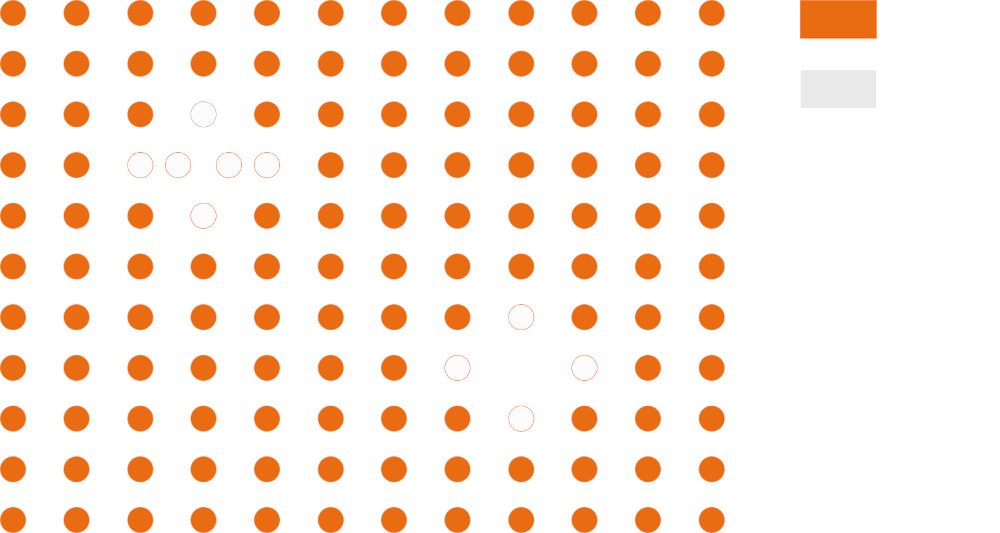
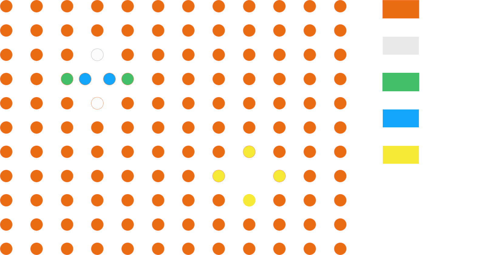
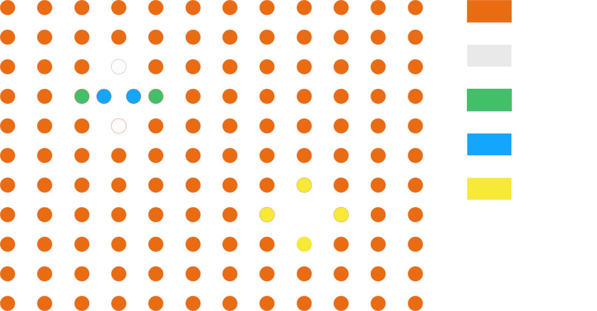
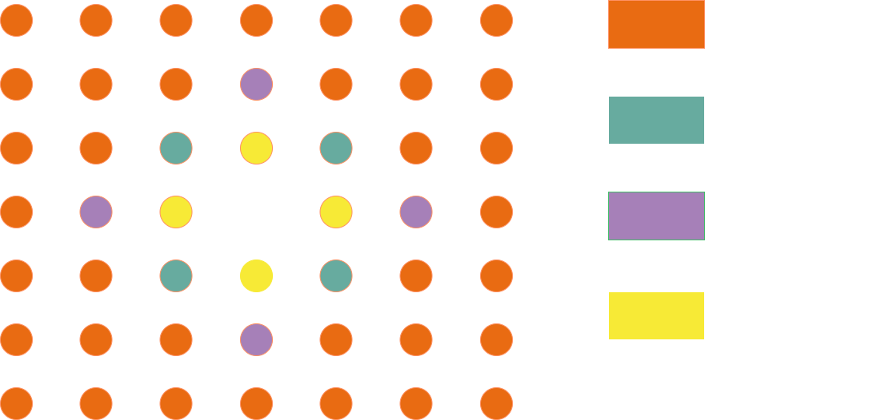
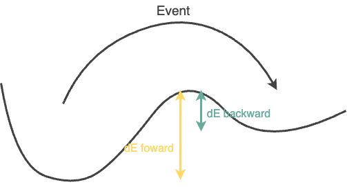

# User Guide 

_This is a temporary user guide that aim to provide basic information on the simulation workflow and how to choose simulation's parameters_ 

pyKMC is an on-the-fly kinetic Monte Carlo (KMC) program.

At each step, if a new atomic environment is encountered, pyKMC performs event searches and adds the resulting generic events to a reference event table.
When a previously visited environment is found again, pyKMC refines the stored reference events to account for elastic deformations, and builds an active event table specific to the current state.

An event is then selected from this active table based on the chosen KMC algorithm and applied to the system, advancing the simulation.

To start a simulation, pyKMC requires a configuration file in the INI format. This file contains general simulation parameters, as well as tool-specific settings needed to run the different stages of the simulation workflow. 

## Control 

The first section of the INI configuration file, called [Control], defines general simulation parameters.
You must provide an initial atomic configuration file, readable by ase.io.read, which includes atomic positions, cell parameters, and periodic boundary conditions (PBC). For example, if using an XYZ file, it should look like:

```bash 
2047
Lattice="28.16 0.0 0.0 0.0 28.16 0.0 0.0 0.0 28.16" pbc="T T T"
Ni       0.00000000       0.00000000       0.00000000       
Ni       0.00000000       1.76000000       1.76000000       
... 
``` 
The path to this file should be provided using the `initial_config` key. 
You must also specify : 
- the number of KMC steps to run with `n_steps`
- the simulation engine to use to compute energy, forces and perform event searches/refinements (e.g., lammps) with the `engine` key

A minimal example of a `[Control]` section would be:
```INI 
[Control] 
initial_config = myconfig.xyz 
n_steps = 100 
engine = lammps
``` 
Additional options in this section allow you to customize output filenames (see the full parameter documentation).
pyKMC also saves the reference event table and the list of visited environments as .pickle files. To reuse them in a new simulation, simply provide their paths:

```INI 
reference_table = my_reference_table.pickle 
visited_environments = my_visited_environments_list.pickle
```  
Alternatively, you may provide only a list of visited environments if you wish to exclude certain environments from being explored.

## Engine 

The INI configuration file must also include a section specific to the engine you selected in the `[Control]` section.
For example, if you set `engine = lammps`, your file should include a `[Lammps]` section.

### Lammps 

When using LAMMPS, you need to specify the potential parameters.
Currently, only pair potentials are supported. You must provide the `pair_style` and `pair_coeff` keys

Additionally, you can change default parameters used during system minimization (see the full parameter documentation). 

A minimal `[Lammps]` section might look like:
```INI 
[Lammps]
pair_style = eam/alloy 
pair_coeff = * * my_file.eam Ni 
``` 

`pair_coeff` can also be a list in square brackets, with elements separated by commas: pyKMC sends one
`pair_coeff` command per element, in order. Hybrid styles need this, since LAMMPS loads them with several
`pair_coeff` lines, each naming its sub-style. `pair_style` is written as in a LAMMPS input.
```INI
[Lammps]
pair_style = hybrid/overlay eam/alloy zbl 1.0 2.0
pair_coeff = [* * eam/alloy my_file.eam Ni, 1 1 zbl 28.0 28.0]
```
sends
```
pair_style hybrid/overlay eam/alloy zbl 1.0 2.0
pair_coeff * * eam/alloy my_file.eam Ni
pair_coeff 1 1 zbl 28.0 28.0
```
A value without brackets is one `pair_coeff` command, sent as written.

#### Another LAMMPS library, and searches and minimizations on a GPU

Six optional keys choose how LAMMPS is opened. With all of them unset pyKMC opens the default library as before.

- `library` : the LAMMPS shared library to open. `library = mtpkk` opens `liblammps_mtpkk.so`, which must be on
  the library path (`LD_LIBRARY_PATH`).
- `cmdargs` : extra LAMMPS command-line arguments for every LAMMPS instance of the run.
- `search_cmdargs` : arguments added only for the instance a `dimer` or `artn` search makes for its force calls.
- `search_pair_style` : the `pair_style` of that instance, when it must differ from `pair_style`.
- `group_cmdargs` : arguments added only for the group instance (`lammps.log.0`), which does the full-cell
  minimizations: the first one and those of event execution.
- `group_pair_style` : the `pair_style` of that instance, when it must differ from `pair_style`.

For example, these settings in an ARTn input run the search force calls, active-volume refinement and
full-cell minimizations on one GPU. The ARTn search uses its default full cell.

```INI
[Control]
active_volume = True
group_size = 1

[ActiveVolume]
rmov = 6.0
ract = 11.7

[EventSearch]
style = artn
nsearch = 2

[Lammps]
pair_style = mtp ./Zr.mtp chunksize 32768
pair_coeff = * *
min_style = cg
library = mtpkk
search_cmdargs = -k on g 1 -sf kk -pk kokkos newton on neigh half
search_pair_style = mtp/small ./Zr.mtp chunksize 32768
group_cmdargs = -k on g 1 -sf kk -pk kokkos newton on neigh half
group_pair_style = mtp/small ./Zr.mtp chunksize 32768
```
- Put KOKKOS arguments in `search_cmdargs` and `group_cmdargs`. Workers that run pARTn searches or refinements
  use the CPU because pARTn requires the FIRE minimizer. With the active volume enabled, a search instance
  that requests a KOKKOS GPU also pre-relaxes and refines the saddle by default. Use `-sf kk` in
  `search_cmdargs` and `min_style = cg`, including when the group instance uses the CPU.
- The group instance never runs pARTn, so `group_cmdargs` also works with `style = partn`. With KOKKOS on it
  needs `-sf kk` and `min_style = cg` (KOKKOS has no other minimizer). Set `group_size = 1` on one GPU: with more
  ranks they share the card, which works but is slower. Give `search_cmdargs` and `group_cmdargs` the same
  `-k on ...` arguments: KOKKOS starts once per process.
- `-sf kk` turns an instance's pair style into its `/kk` variant. Without `search_pair_style` or
  `group_pair_style` that is `pair_style`, so one line must be valid for both: `mtp/kk` needs the `chunksize`
  argument and the CPU `mtp` accepts it. `mtp/small/kk`, the style for a few hundred to a few thousand atoms, has
  no CPU version, which is what the two keys are for. `pair_coeff` is shared.
- LAMMPS has no type labels with KOKKOS on, so pyKMC does not send its `labelmap` command to such an instance
  and `pair_coeff` cannot use type labels there.
- When the GPU pays. The card serves one process at a time, so every worker opens the same GPU and a force call
  takes about N times longer with N workers searching at once: the GPU gives a fixed number of calls per second
  however many workers share it. Measured with a level-28 Zr MTP on an RTX 3090 against one Zen 2 core, per call:

  | atoms | CPU `mtp` | `mtp/kk` | `mtp/small/kk` | `mtp/kk`, 6 workers | `mtp/small/kk`, 6 workers |
  |---:|---:|---:|---:|---:|---:|
  | 448 | 136 ms | 76 ms | 8 ms | 437 ms | 45 ms |
  | 1,440 | 432 ms | 79 ms | 17 ms | 449 ms | 96 ms |

  `mtp/kk` costs about 75 ms per chunk of atoms whatever the chunk holds, so on an active volume of a few hundred
  atoms it is slower than the CPU as soon as two workers share the card; use `mtp/small/kk` there.
- The group instance has the card to itself: pyKMC never runs a full-cell minimization while workers search.
  On the same machine one minimization of a 1,441-atom Zr cell (61 iterations) takes 44 s on a core, 12.5 s with
  `mtp/kk` and 2.5 s with `mtp/small/kk`, and ends at the same minimum.

## Atomic Environment 

During the simulation, at each step, pyKMC assigns an atomic environment ID to every atom in the system.
This ID serves as a unique fingerprint of the atom’s local environment, allowing pyKMC to identify recurring configurations.

Each reference event is also tagged with an environment ID, corresponding to the initial local configuration of the event’s central atom—the atom that moves the most during the transition. For events, IDs are always computed using the graph style (see below).

To determine whether a stored reference event can be reused, pyKMC compares the event's environment ID with those computed in the current system.

Different ID generation strategies (called styles) are available to define atomic environments. 

To define parameters related to the generation of those IDs, the INI configuration file should contain an `[AtomicEnvironment]` section. 

The two main parameters are specified by the `rnei` and `rcut` keys. `rnei` defines the first nearest neighbors of an atom. Atoms within this distance are considered direct neighbors. `rcut`defines the atomic environment sphere, atoms in this sphere are part of the local atomic environment. 

You can select the method (or style) used to assign an atomic environment ID to each atom.
The available styles are:
- cna : 
In this mode, pyKMC counts the number of neighbors around each atom and checks whether it matches a typical crystalline coordination number (6, 8, or 12).
    - if the atom has one of these neighbor counts, it is labeled "crystal".
    - Otherwise, it is labeled "noncrystal".
<div style="display: flex; align-items: center; justify-content: center; gap: 20px;">
  
  <div style="text-align: center; font-weight: bold;">
    Using style=cna gives: 
  </div>
  
</div>

- graph : 
In this style, pyKMC constructs a graph from each atom's environment using pyNauty. 
A unique, canonical certificate (a binary) is then computed using pyNauty, serving as the atom’s environment ID.
<div style="display: flex; align-items: center; justify-content: center; gap: 20px;">
  
  <div style="text-align: center; font-weight: bold;">
    Using style=graph gives: 
  </div>
  
</div>

- cna/graph : 
In large systems, many atoms are in a perfect crystalline environment. Computing graph-based IDs for all of them is inefficient.
This hybrid mode provides a compromise: 
    - First, a CNA classification is performed. 
    - If an atom is labeled "crystal", it keeps this simple ID. 
    - If it is labeled "noncrystal", a graph-based ID is computed. 
<div style="display: flex; align-items: center; justify-content: center; gap: 20px;">
  
  <div style="text-align: center; font-weight: bold;">
    Using style=cna/graph gives: 
  </div>
  
</div>

When searching for an event around a "noncrystal" atom, it may happen that another atom ends up being the one that moves the most. In this case, the resulting event will be tagged with the graph ID of that other atom.
If this ID corresponds to a "crystal" atom in the current system, that event will never be selected. 

To avoid this issue, you can instruct pyKMC to expand the graph style to the nth neighbors of the "noncrystal" atom using the `neighbors_add` key. 

For example, when looking at a vacancy with `neighbors_add = 1` it gives: 

<div style="text-align: center;">

</div>

Finally, the `[AtomicEnvironment]` section of the INI configuration file will look like this : 
```INI 
[AtomicEnvironment] 
style = cna/graph
rnei = 3.0 
rcut = 6.5 
neighbors_add = 1 
``` 
## Event Search 

The `[EventSearch]` section lets you define:
- the algorithm used to search for new events,
- the criteria used to keep or discard events in the reference event table,
- if a refinement is successful.

This section requires two mandatory keys:
- `style` : the algorithm used to perform event searches: `partn`, `dimer` (see [Dimer](#dimer) below) or `artn`
  (see [ARTn in pyKMC](#artn-in-pykmc) below).
- `nsearch` : number of event searches to perform per atomic environment.

A minimal `[EventSearch]` section looks like:
```INI 
[EventSearch] 
style = partn 
nsearch = 50 
``` 

When an event is found, it is characterized by two energy barriers, a forward energy barrier $dE_{forward}$ and an inverse energy barrier $dE_{backward}$ : 
<div style="text-align: center;">
  
  <div style="font-size: 0.9em; color: gray; margin-top: 5px;">
    Potential energy surface
  </div>
</div>

The event is added to the reference table only if it satisfies all the following conditions:

- $dE_{forward}$ < `emax_event` 
- $dE_{forward}$ > `emin_event` 
- $dE_{backward}$ > `emin_event` 
- it is not highly asymmetric: the event is rejected if both $dE_{forward}$ > `energy_asymmetry` x `backward_emin_event` and $dE_{backward}$ < `backward_emin_event`. 

Once a reference event is reused, it is refined to adapt to the current atomic configuration. The refinement is considered successful if:
- The central atom moves less than `refined_minimum_delr_thr` between the current position and the refined minimum.
- The difference in energy barriers between the generic and refined events is less than `refined_energy_thr`.
These thresholds ensure that the refined event remains consistent with the original.
Each refinement whose barrier differs from the reference one by more than `refined_energy_thr`, or that gives up
because its refined saddle moved `r_delr_sad_thr` or more (in `[pARTn]`), is written to the log with its reference
event and the size of the difference.

Each event search is also recorded in the info file (`pykmc.info`), under `reference_event_searches` at the end of
its step, in search order. A record holds the central atom and what the search reported: the backend (`dimer` or
`partn`), its seed, the failure reason of a failed search, the energies of the initial minimum, the saddle and the
final minimum (eV), the force calls up to the saddle (or the failure) and after it, the curvature at the saddle
(eV/Ų), and the unstable mode at the saddle, a unit vector pointing from the initial minimum to the saddle,
written as one row `[atom, x, y, z]` per atom with a non-zero component. A successful search has no failure
reason. With `verbosity = 2` the log also has one line per search, with the mode's three largest atoms; with
`verbosity = 0` no record is written. pARTn reports its seed only when `zseed` is not 0, and as curvature and mode
its last Lanczos eigenvalue and vector, not recomputed at the converged saddle. With every atom movable the mode
has a row for every atom, so each successful search adds about 50 bytes per atom to the info file. These records
are not read back by pyKMC: the reference table and restart files do not change.

To further control the behavior of the selected event search algorithm (style), you must define a separate section matching the algorithm name. For instance, if you choose `style = partn` you must also include a `[pARTn]` section in your INI file to configure specific parameters for the pARTn method. 

### pARTn 

All other parameters have default values (see the full parameter documentation), but depending on your system, you may need to adjust some of them for optimal performance.
Parameters related to refinements are prefixed with r_

A minimal `[pARTn]` section will look like this : 
```INI 
[pARTn] 
delr_thr = 0.1
r_eigval_thr = -0.02
```

For a detailed explanation of the pARTn algorithm and its parameters, please refer to the official pARTn documentation.

### Dimer

With `style = dimer`, pyKMC finds new events with the dimer method (ported from SEAKMC, Liang and Xu 2023).
A dimer run needs both a `[Dimer]` section for the search and a `[pARTn]` section for the refiner's `r_`
parameters. See [Refinement with ARTn](#refinement-with-artn).

Each search starts from a random direction, drawn from a seed. With `seed` set in `[Control]`, the run draws
the same seeds in the same order whatever the number of LAMMPS instances.

The atoms a dimer search may move follow the active volume setting: with `active_volume = True` in `[Control]`,
the atoms within `rmov` of the central atom move; otherwise every atom moves. Atoms in `[frozen_atoms]` never move.
The dimer keeps the whole system's coordinates, with the other atoms held fixed. By default its force
calculation also uses the full cell. On a large cell with every atom movable, the dimer can follow the
cell's soft long-wavelength modes instead of a local event, so the active volume is recommended there.

A minimal `[Dimer]` section looks like:
```INI
[Dimer]
start = local
start_radius = 3.0
```

- `start` : `local` (default) draws the starting direction on the movable atoms within `start_radius` (in Å) of the
  central atom; `region` draws it on all movable atoms. `start_radius` is required with `local`.
- `convergence` and `force_tolerance` : the search has converged when the largest force component
  (`max_component`, the default, as pARTn's `forc_thr`) or the 3N force norm (`norm`) is below `force_tolerance`
  (default 1e-3 eV/Å), and the curvature at the saddle is negative.
- `separation`, `trial_step` and `max_step` : the dimer's half-length and its two translation step sizes, in Å
  (defaults 0.005, 0.015 and 0.05).
- `dav` : SEAKMC's dynamic active volume (Liang and Xu 2023), on by default. While the dimer climbs out of the
  basin, its direction is weighted atom by atom towards the atoms that move most. The weights come from the movable
  atoms only; DAV never adds or removes atoms and is separate from `active_volume` in `[Control]`.
- `reuse_neighbor_list` : reuse LAMMPS neighbor lists between dimer force evaluations, on by default
  with the `eam/alloy`, `eam/fs`, `mtp` or `mtp/small` pair style (and their KOKKOS `/kk` variants). Each
  search starts with a fresh list.
  LAMMPS checks subsequent displacements against its neighbor skin. The option applies only to the
  dimer worker's private LAMMPS instance. With another pair style the default is off, and
  `reuse_neighbor_list = True` is an error.
- Set `eam_force_crop = True` to omit distant frozen atoms from force evaluations with native
  `eam/alloy` or `eam/fs`. This is useful when only a small region can move. The worker keeps two
  interaction cutoffs around the movable region so it can evaluate the electron density of the
  movable atoms' neighbors. It uses the full system to establish the energy reference for each
  search. It uses the full cell if less than 10% of the atoms can be omitted, and switches back
  to the full cell if a movable atom leaves the guarded region or a frozen atom changes position.
  The option defaults to `False` and can be combined with `reuse_neighbor_list = True`.

Each dimer search runs on one LAMMPS instance of its own, on the first rank of its session. A session with several
ranks therefore gets no speed-up on dimer force calls: its other ranks wait while the search runs. Use more
sessions with fewer ranks each instead.

### ARTn in pyKMC

With `style = artn`, new events are found by pyKMC's own ARTn, a Python port of pARTn v1.1.0 (Poberznik et al.
2024). The search reads its parameters from the `[pARTn]` section. Each search counts every force call and runs on a private LAMMPS instance using all ranks
of its worker. As for the dimer, the movable atoms are those within `rmov` of the central atom with the active
volume on and all atoms otherwise, excluding `[frozen_atoms]` in both cases. For `eam/alloy`, `eam/fs`, `mtp`
and `mtp/small`, every worker reuses neighbor lists between force calls, as the dimer does by default. The ARTn input file cannot
change this.

Each search is seeded from the run-wide stream that `seed` in `[Control]` starts, as for the dimer, so a run with
the same seed finds the same events whatever the number of LAMMPS instances. `zseed` does not seed these searches;
pARTn's refinement still reads it.

On leaving the basin, the first `nsmooth` pushes blend the last basin push into the first uphill eigenvector.
With `nsmooth = 0` the pushes follow the eigenvector from the start. The core builds a sequence of perpendicular
FIRE step limits from `nperp` and `nperp_limitation`. Each relaxation out of the basin uses the next limit, and
the last limit repeats once the sequence runs out. A limit of `-1` leaves the step count uncapped.
If the lowest eigenvalue becomes positive after leaving the basin, `nnewchance` allows that many new attempts
with the initial push mixed with a random direction. The log names, once, each `[pARTn]` setting that the ARTn
search ignores.

With the active volume on, `artn_forces` in `[ActiveVolume]` chooses where the ARTn search evaluates forces:

- `full` (the search default) uses the full system, as for the dimer. Atoms beyond `rmov` stay fixed and see zero force.
- `av`: pARTn's active volume, built as for `style = partn`: only the atoms within `ract` of the central atom,
  in a periodic box with the cell's edges, and zero force on those beyond `rmov`. As under pARTn, the search still
  moves those atoms slightly (by about 1e-4 Å), and the energies are the active volume's. The forces are then pARTn's, so
  this setting is for comparing the search with pARTn's. It needs an orthogonal cell with its edges along x, y and
  z. As for the dimer, each active-volume search runs on the first rank of its session. A session with several
  ranks therefore gets no speed-up: its other ranks wait while the search runs. Use more sessions with fewer ranks
  each instead. For `eam/alloy`, `eam/fs`, `mtp` and `mtp/small` it reuses neighbor lists between force calls too,
  which changes the cost of a force call and not the search.

```ini
[ActiveVolume]
rmov = 10.7
ract = 14.2
artn_forces = av
```

### Refinement with ARTn

When `[Control] active_volume = True` and the private search instance requests at least one KOKKOS GPU,
pyKMC defaults to its Python ARTn refiner on the active volume. The search instance receives `cmdargs` followed
by `search_cmdargs`. This refiner pre-relaxes on that instance, so the default needs `[Lammps] min_style = cg`
and `-sf kk` in those arguments (KOKKOS minimizes only with `cg/kk`); without them pyKMC keeps pARTn and logs
why. The default elsewhere is pARTn, including runs that request a GPU only in `group_cmdargs`.

For any search style, `[EventSearch] refine_style = partn` or `artn` explicitly selects the refiner.
Both read the `r_` parameters of `[pARTn]`. With `artn_forces` omitted, a Python ARTn search uses the
full cell. A Python ARTn refinement uses the active volume under the GPU conditions above and the full
cell elsewhere. Setting `[ActiveVolume] artn_forces` to `full` or `av` selects that region for both
Python ARTn operations when the active volume is enabled.

The ARTn refiner sets
the rcut atoms at the reference saddle, relaxes the other atoms with LAMMPS (`min_style`, `frz_min`; with the
active volume on, only those within `rmov`), then runs ARTn from there, stopping at the saddle, up to
`r_max_attempts` times. A saddle closer than `r_delr_sad_thr` to the start is accepted. Each attempt starts
afresh with its own seed, drawn from a stream of its own that `seed` in `[Control]` starts, so adding refinement
changes no search seed and the seeds do not depend on the number of LAMMPS instances. `zseed` is not read, and
`r_neigen` other than 1 is logged as ignored. The barrier is the saddle's potential energy minus the minimum's,
with or without the active volume. For refinement on the active volume, the first rank of each session builds
the same active volume as pARTn. It measures the minimum energy there, sets the rcut atoms at the reference saddle,
and holds them and the buffer fixed while the remaining atoms relax. Pre-relaxation and saddle refinement
both use the search instance and its `search_cmdargs` and `search_pair_style`. The shared pARTn pre-relaxation
can move an explicitly frozen atom inside `rmov` and outside the rcut group. The ARTn iterations then hold
that atom at its pre-relaxed position.

```ini
[EventSearch]
style = artn
nsearch = 50
refine_style = artn
```

## Rate Constant 

Each time an event is added to either the reference or the active event table, a rate constant is computed. The method used to compute this rate is defined in the [RateConstant] section of the INI configuration file.

Currently, the only implemented style is : `style = constant`. This method computes the rate constant using the following equation. 

$$
k = k_{0} e^{-\frac{dE_{forward}}{{k_{b}T}}}
$$
Where:
- $k$ is the rate constant,
- $k_{0}$ is a user-defined pre-exponential factor (typically $10^{13}s^{-1}=10ps^{-1}$),
- $T$ is the system temperature, defined by the user.
- $dE_{forward}$ is the forward energy barrier,
- $k_{b}$​ is the Boltzmann constant.

All parameters must be provided in LAMMPS metal units ($k_{0}$ in $ps^{-1}$, $T$ in K).

Typically, it gives:

```INI 
[RateConstant]
style = constant 
k0 = 10
T = 300 
``` 

## PSR 

When applying a reference event to a system for refinement, pyKMC performs a point set registration (also known as shape matching) to align the atomic positions from the reference event with the local atomic environment of the atom currently targeted for refinement.

You can define the algorithm to use with the `style` key. _Currently only 'ira' is implemented_.  This is the only mandatory parameter. 

You may also want to adjust the default value of matching_score_thr, which sets the maximum allowed matching score for a successful registration.
For `style = ira`, the matching score corresponds to the Hausdorff distance between the two point sets.

This gives:
```INI 
[PSR]
style = ira 
matching_score_thr = 0.3 
``` 

As with the Engine and EventSearch parts, you must also include a dedicated section for the selected point set registration method.

### IRA 

When using IRA, you can change the default parameters. For a full explanation, please refer to the full parameters documentation and the IRA documentation. 
To ensure access to default values, the section must be present in the configuration file, even if it's empty.

## Final configuration file 

Finally, based on the previous examples, a complete INI configuration file would look like this:

```INI 
[Control] 
initial_config = myconfig.xyz 
n_steps = 100 
engine = lammps

[Lammps]
pair_style = eam/alloy 
pair_coeff = * * my_file.eam Ni 

[AtomicEnvironment] 
style = cna/graph
rnei = 3.0 
rcut = 6.5 
neighbors_add = 1  

[EventSearch] 
style = partn 
nsearch = 50  

[pARTn] 
delr_thr = 0.1
r_eigval_thr = -0.02

[RateConstant]
style = constant 
k0 = 10 
T = 300  

[PSR]
style = ira 
matching_score_thr = 0.3  

[IRA] 
```

## How to restart a simulation

When a simulation completes its `n_steps` KMC steps, pyKMC writes a restart file named `restart_<last_step>.npz` (e.g. `restart_100.npz`). This file stores the last KMC step, the simulated time reached and the elapsed wall time.

During the simulation, pyKMC also writes:

- the trajectory (`trajkmc.xyz` by default, see `trajectory_output`),
- the reference event table (`reference_table.pickle` by default, see `reference_table_output`),
- the list of visited environments (`visited_environments.pickle` by default, see `visited_environments_output`).

To restart, give the restart file with the `restart_file` key in the `[Control]` section. You can set `initial_config` directly to the trajectory file: pyKMC always reads the last configuration of the file. To reuse the events and environments that were already explored, also give the reference table and the visited environments:

```INI 
[Control] 
initial_config = trajkmc.xyz 
restart_file = restart_100.npz 
reference_table = reference_table.pickle 
visited_environments = visited_environments.pickle 
n_steps = 100 
engine = lammps
``` 

On restart:

- `n_steps` is the number of **additional** steps to run. In the example above, the simulation continues from step 101 to step 200.
- The step counter, the simulated time and the wall time continue from the values in the restart file.
- The system is not minimized again: the positions read from `initial_config` are kept as they are.
- The trajectory and output files are appended to instead of being overwritten.

_A restart file is written only when all `n_steps` steps are completed. It is not written if the simulation stops earlier._

## Running a simulation

pyKMC requires MPI and must be run with at least two MPI ranks: rank 0 runs the main KMC loop, and the other ranks run the LAMMPS instance(s).

Once both the input file and the initial configuration file are ready, launch the simulation by executing:

```bash 
mpirun -n 2 python -m pykmc -in <your_input_file_name> 
``` 

## Using multiple lammps instances 

To speed up event searches and the refinement part of the KMC loop, it is possible to use multiple LAMMPS instances.
Each instance runs independently on a separate set of cores.

The number of instances is defined by the `n_sessions` parameter in the `[Control]` section of the input file.
The main KMC loop always runs on rank 0, and the LAMMPS instances share the remaining ranks. You therefore need at least `n_sessions + 1` MPI ranks.

For example, if you have 8 cores available and want to run 4 LAMMPS instances, your input file should contain the following parameters:

```INI 
[Control]
...
n_sessions = 4 
... 
``` 

You can then start the simulation with:
```bash 
mpirun -n 8 python -m pykmc -in <your_input_file> 
``` 
The available cores will be automatically split according to your configuration.
In this example, the LAMMPS instances will run on ranks 1–2, 3–4, 5–6, and 7, while the main KMC loop runs on rank 0.


